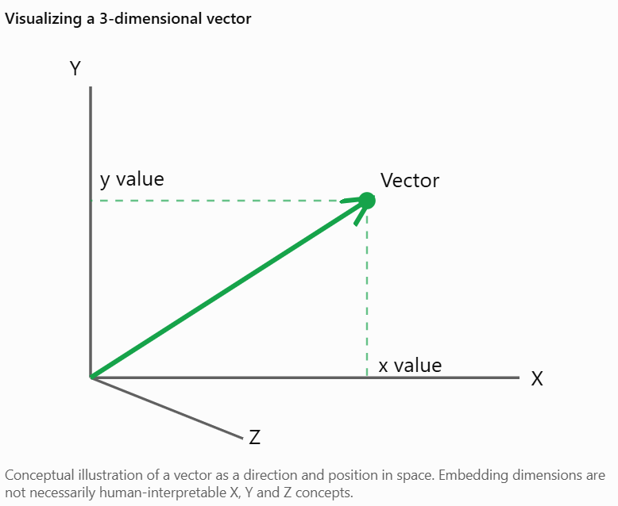
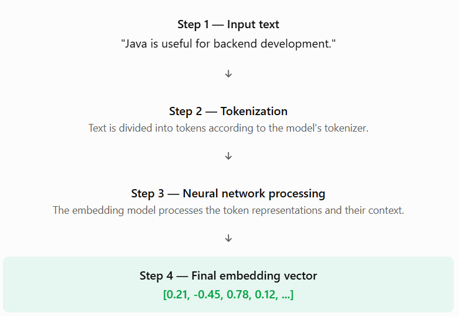
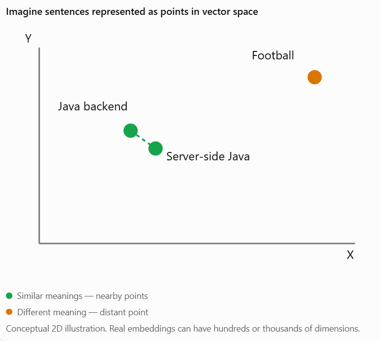
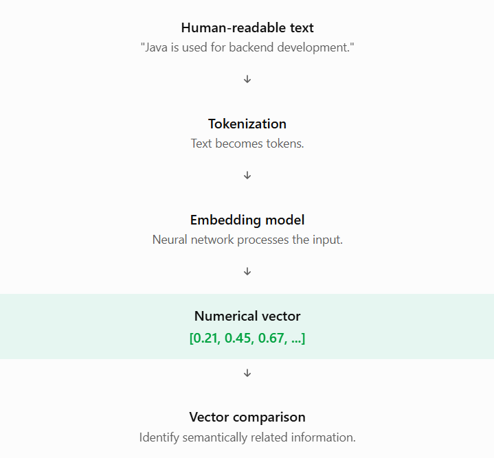

# Topic 4.2 — How Embeddings Work

By the end of this lesson, you'll understand how a sentence becomes numbers, what those numbers represent, and why sentences with similar meanings can have similar numerical representations.

This topic is important because before using Spring AI's `EmbeddingModel` or PostgreSQL's pgvector, you should understand what you're actually generating and storing.

# 1. What is a vector?

Let's start with the foundation.

A vector is an ordered collection of numerical values.

For example:

\\[ V = [0.25,\ 0.45,\ 0.78] \\]

This is a vector containing three numerical values.

In mathematics and computer science, vectors can represent information in a multidimensional space.

For embeddings, we use vectors to represent the meaning of input data.

Consider these examples:

| Vector                     | Dimensions |
| -------------------------- | ---------- |
| `[0.25, 0.45]`             | 2          |
| `[0.25, 0.45, 0.78]`       | 3          |
| `[0.25, 0.45, 0.78, 0.12]` | 4          |

Important terminology:

A dimension is one numerical position in a vector.

For example:

\\[ V = [0.25,\ 0.45,\ 0.78] \\]

- First dimension = 0.25
- Second dimension = 0.45
- Third dimension = 0.78

Therefore, this vector has three dimensions.



For now, remember:

Vector = Ordered collection of numerical values.

Dimensions = Number of values in that vector.

# 2. How does text become numerical vectors?

Now let's understand the actual embedding process.

Suppose a student enters this sentence:

"Java is useful for backend development."

A computer cannot directly perform mathematical similarity calculations on the meaning of this sentence.

An embedding model solves this problem.

The simplified process looks like this:



Let's understand each step.

### Step 1: Input text

The user provides ordinary text.

```
Java is useful for backend development.
```

### Step 2: Tokenization

The model's tokenizer divides the text into smaller units called tokens.

A simplified illustration might be:

```
["Java", "is", "useful", "for", "backend", "development"]
```

Actual tokenization may split words further, depending on the model.

### Step 3: Neural network processing

The embedding model processes the token representations.

It learns patterns and relationships from training data.

For example, it may learn that:

- Java is related to programming.
- Backend is related to server-side development.
- Spring Boot is related to Java backend development.

It uses learned numerical representations and contextual information to create an overall representation.

### Step 4: Generate embedding

The model produces a vector representing the input.

For illustration:

```
float[] embedding = {
    0.21f,
    -0.45f,
    0.78f,
    0.12f,
    -0.33f
};
```

This vector contains five dimensions in our simplified example.

Real embedding models commonly generate vectors with hundreds or thousands of dimensions.

Important: The numbers above are made-up examples for understanding. Real values come from the embedding model.

# 3. What does an embedding vector actually represent?

This is probably the most important part of today's lesson.

Consider these three sentences:

Sentence A:

"Java is used for backend development."

Sentence B:

"Java helps developers build server-side applications."

Sentence C:

"I enjoy playing football."

An embedding model generates a vector for each sentence.

For example:

| Sentence | Illustrative vector    |
| -------- | ---------------------- |
| A        | `[0.21, 0.45, 0.67]`   |
| B        | `[0.23, 0.43, 0.69]`   |
| C        | `[-0.61, 0.12, -0.38]` |

Notice that A and B have similar numerical values, while C has different values.

This illustrates an important principle:

Texts with similar meanings often have nearby embeddings in vector space.

But what does that mean?

An embedding vector captures patterns and semantic information learned by the model.

It does NOT mean:

- Dimension 1 represents Java.
- Dimension 2 represents programming.
- Dimension 3 represents backend development.

Individual dimensions generally don't have simple human-readable meanings.

Instead, the meaning is distributed across the vector's dimensions.

Think of it this way:

Imagine describing a student using several numerical measurements. No single measurement describes the student's entire personality. Together, the measurements provide a representation.

Embeddings work somewhat similarly, except their dimensions are learned mathematical features rather than manually defined characteristics.

## Visual example



This is why embeddings are useful for semantic search.

# 4. Why do similar meanings produce similar vectors?

You might be wondering:

"How does the model know that backend development and server-side development are related?"

Excellent question!

The answer is machine learning and training.

Embedding models are trained using large collections of data and learning objectives that teach them to represent semantic relationships.

During training, the model learns patterns such as:

- Similar sentences should have related representations.
- Different meanings should generally have less similar representations.
- Context helps determine the meaning of words.

For example:

| Sentence A        | Sentence B              | Expected relationship |
| ----------------- | ----------------------- | --------------------- |
| Java developer    | Backend Java programmer | Similar               |
| Learn Spring Boot | Study Spring Framework  | Related               |
| Java programming  | Playing cricket         | Less similar          |

The model learns these relationships through training rather than through manually written rules.

Important clarification: Not every embedding model is trained in exactly the same way. Also, similar meanings do not guarantee identical vectors or a particular similarity score.

## A practical example from your platform

Imagine your Career Management Platform contains these records:

```
Document 1:
Java is an important language for backend development.

Document 2:
Spring Boot simplifies server-side application development.

Document 3:
Football is a popular outdoor sport.
```

A student asks:

```
What technologies should I learn to build server applications?
```

Your embedding model converts the query into a vector.

Your stored documents already have their own vectors.

The system compares the query vector against the stored vectors and ranks the most relevant documents.

This is how semantic retrieval becomes possible.

# 5. Understanding embedding dimensions

Now let's discuss something that will become very important when we integrate Gemini and PostgreSQL pgvector.

What are embedding dimensions?

Suppose an embedding model generates this vector:

```
float[] vector = {
    0.12f,
    0.45f,
    -0.21f,
    0.78f,
    0.33f
};
```

It has five numerical values.

Therefore:

\\[ \text{Dimensions} = 5 \\]

Now imagine another embedding model generates 768 numerical values for the same text.

Its embedding dimension is 768.

### Why do dimensions matter?

Different embedding models can generate vectors of different dimensions.

For example, imagine:

| Model   | Illustrative dimensions |
| ------- | ----------------------- |
| Model A | 384                     |
| Model B | 768                     |
| Model C | 1536                    |

These are illustrative dimensions, not claims about particular current model configurations.

A critical rule:

Vectors being compared must belong to compatible embedding spaces and have compatible dimensions.

You cannot simply compare a 384-dimensional vector with a 768-dimensional vector using ordinary cosine similarity.

This will also matter when creating a PostgreSQL pgvector column.

For example:

```
CREATE TABLE career_documents (
    id BIGSERIAL PRIMARY KEY,
    content TEXT,
    embedding VECTOR(768)
);
```

Here, the database column expects exactly 768 dimensions.

We'll study this properly when we configure pgvector in Topic 4.11 and Spring AI in Topic 4.14.

# 6. Important concepts you must remember

Let's revise everything from today's lesson.

| Term                  | Explanation                                         |
| --------------------- | --------------------------------------------------- |
| Vector                | Ordered collection of numerical values              |
| Dimension             | One numerical position in a vector                  |
| Tokenization          | Dividing text into tokens                           |
| Embedding model       | Model that generates numerical representations      |
| Embedding vector      | Numerical representation of input information       |
| Vector space          | Mathematical space in which vectors are represented |
| Semantic relationship | Relationship between meanings of information        |

### The complete process



