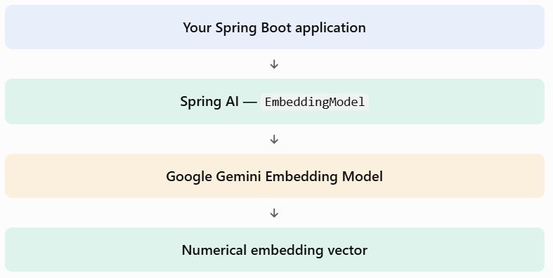

# Topic 4.4 — Generating Embeddings Using Spring AI

### 1. What are we going to learn?

In the previous topics, we learned that an embedding model converts text into a numerical vector.

Now imagine we have this sentence:

```
Spring Boot is a Java framework for building backend applications.
```

We want Spring AI to send this text to an embedding model and receive a vector:

```
[0.21, -0.45, 0.78, 0.12, ...]
```

Instead of manually calling Google's API, Spring AI provides an abstraction called `EmbeddingModel`.

### 2. What is `EmbeddingModel`?

`EmbeddingModel` is a Spring AI interface that provides a common way to generate embeddings, regardless of the underlying AI provider.

For example:



Why is this useful?

Suppose today you use Google's embedding model, but later you want to switch to another supported provider.

Your application can continue using Spring AI's `EmbeddingModel` abstraction. You may need to change provider configuration, but your application code doesn't necessarily need to change.

### 3. Important methods in `EmbeddingModel`

Spring AI gives us a few useful methods:

| Method                                 | Purpose                                    | Returns             |
| -------------------------------------- | ------------------------------------------ | ------------------- |
| `embed(String text)`                   | Generate an embedding for one text         | `float[]`           |
| `embed(List<String> texts)`            | Generate embeddings for multiple texts     | `List<float[]>`     |
| `embedForResponse(List<String> texts)` | Generate embeddings with response metadata | `EmbeddingResponse` |
| `dimensions()`                         | Get the vector dimension count             | `int`               |

For now, focus on these two:

A. `embed()`

```
float[] vector = embeddingModel.embed("I love Java programming");
```

It directly gives you a numerical vector.

B. `embedForResponse()`

```
EmbeddingResponse response =
        embeddingModel.embedForResponse(
                List.of("I love Java programming")
        );
```

It returns an `EmbeddingResponse`, which contains the generated embedding results and response metadata.

The `EmbeddingModel` interface also supports batch input, so you can generate embeddings for multiple sentences in one operation.


### 4. Configure Google Gemini embeddings

One important detail before coding: your existing Google GenAI chat starter and the Google GenAI embedding starter are separate dependencies. Add the embedding starter as well.

In your existing `pom.xml`, add:

```
<dependency>
    <groupId>org.springframework.ai</groupId>
    <artifactId>spring-ai-starter-model-google-genai-embedding</artifactId>
</dependency>
```

Keep your existing Spring AI BOM and chat starter. Don't add a second Spring AI version manually.

For the Google GenAI text embedding integration, the current Spring AI documentation uses a separate embedding configuration and supports task types such as `RETRIEVAL_DOCUMENT` and `RETRIEVAL_QUERY`.


For your existing project, add these properties to `src/main/resources/application.properties`:

```
# Google Gemini Embedding Configuration
spring.ai.google.genai.embedding.api-key=${GEMINI_API_KEY}
spring.ai.google.genai.embedding.text.model=text-embedding-004
```

Set `GEMINI_API_KEY` as an environment variable in your IntelliJ run configuration. Don't paste your actual key into source code or share it here.

The `text-embedding-004` model is the model name documented for this integration. Before running, make sure it is still available to your Google API key and account. The embedding API has its own model access and quota considerations; having a working Gemini chat model does not automatically guarantee embedding access.


### 5. Build a REST API to generate embeddings

Let's create a small API that accepts text and returns its embedding.

Project structure

```
src/main/java/com/example/Phase2/
    controller/
        EmbeddingController.java
    dto/
        EmbeddingRequest.java
        EmbeddingResponse.java
```

Step 1 — Request DTO

`EmbeddingRequest.java`

```
package com.example.Phase2.dto;

public record EmbeddingRequest(String text) {
}
```

This represents the text that the client sends.

Step 2 — Response DTO

`EmbeddingResponse.java`

```
package com.example.Phase2.dto;

public record EmbeddingResponse(
        int dimensions,
        float[] vector
) {
}
```

We return:

- `dimensions`: number of values in the vector.
- `vector`: the actual generated embedding.

Step 3 — Controller

`EmbeddingController.java`

```
package com.example.Phase2.controller;

import com.example.Phase2.dto.EmbeddingRequest;
import com.example.Phase2.dto.EmbeddingResponse;
import org.springframework.ai.embedding.EmbeddingModel;
import org.springframework.web.bind.annotation.*;

@RestController
@RequestMapping("/api/embeddings")
public class EmbeddingController {

    private final EmbeddingModel embeddingModel;

    public EmbeddingController(EmbeddingModel embeddingModel) {
        this.embeddingModel = embeddingModel;
    }

    @PostMapping
    public EmbeddingResponse generateEmbedding(
            @RequestBody EmbeddingRequest request) {

        float[] vector = embeddingModel.embed(request.text());

        return new EmbeddingResponse(
                vector.length,
                vector
        );
    }
}
```

Understand what happens here:

1. Spring Boot automatically configures an `EmbeddingModel` bean using the Google GenAI embedding starter.
2. Spring injects that bean through the constructor.
3. The client sends text to our REST endpoint.
4. `embeddingModel.embed()` sends the text to the configured embedding model.
5. Google generates a numerical vector.
6. Our API returns that vector to the client.

Notice that we didn't manually create a Google API client or call Google's HTTP endpoint. Spring AI handles that integration for us.

### 6. Test it using Postman

Start your Spring Boot application in IntelliJ.

POST endpoint

URL

```
POST http://localhost:8080/api/embeddings
```

Body → raw → JSON

```
{
  "text": "Spring Boot is used to develop Java backend applications."
}
```

Expected response structure (illustrative values, not actual model output):

```
{
  "dimensions": 768,
  "vector": [
    0.1234,
    -0.2345,
    0.4567
  ]
}
```

The actual vector will contain all the dimensions returned by your configured model. Don't worry if the response is very large!

### 7. Generating embeddings for multiple texts

Spring AI also supports batch generation.

```
List<String> texts = List.of(
    "Java is a programming language.",
    "Spring Boot simplifies Java backend development.",
    "Python is popular for data science."
);

List<float[]> vectors = embeddingModel.embed(texts);
```

Here:

- We provide three sentences.
- Spring AI generates three vectors.
- Each vector corresponds to its input sentence.
- The returned list preserves the input order.

This is useful when importing many career documents into your future Career Knowledge Search Engine.


## 8. Why do we use this in real applications?

Think about your AI Skill and Career Management Platform.

A student adds this career document:

> Java backend developers should understand Spring Boot, REST APIs, SQL and database management.

Your application generates an embedding for that document and eventually stores it in a vector database.

Later, a student searches:

> What should I learn to become a backend developer?

The application can generate an embedding for the question and compare it with stored document embeddings.

That's the foundation of semantic search. We'll build this step by step in the upcoming topics.
