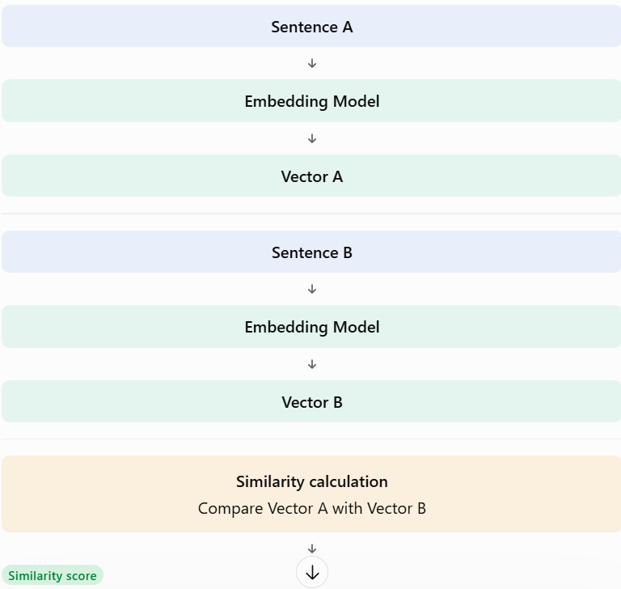

# Topic 4.5 — Semantic Similarity

### 1. What is semantic similarity?

Semantic similarity means measuring how close two pieces of text are in meaning, rather than simply checking whether they contain the same words.

Consider these sentences:

Sentence A

"I want to become a Java backend developer."

Sentence B

"I want to build server-side applications using Java."

High semantic similarity

Different words, but they communicate closely related ideas.

Sentence C

"I enjoy cooking Italian food."

Low semantic similarity

The meaning is unrelated to the Java backend topic.

A semantic similarity system can identify that A and B are related even though they don't use exactly the same words.

### 2. How does Spring AI help us measure similarity?

Remember our previous topic: an embedding model converts text into vectors.

We can use those vectors to calculate how similar two texts are.

The process:

The important idea: we compare the numerical vectors, not the original sentences directly.

### 3. What is a similarity score?

A similarity score is a numerical value representing how closely two vectors are related under a chosen similarity measure.

For example, imagine we calculate these scores:

| Comparison | Illustrative score | Meaning          |
| ---------- | ------------------ | ---------------- |
| A vs B     | 0.92               | Very similar     |
| A vs C     | 0.08               | Not very similar |

These are illustrative values, not actual Gemini results.

A higher score generally indicates greater similarity when using a similarity measure such as cosine similarity.

### 4. What is cosine similarity?

One commonly used method is cosine similarity.

It measures the angle between two vectors.

Imagine two arrows:

[What is a Vector Database? Essential Guide for GenAI Developers](https://images.openai.com/static-rsc-4/E9V-rAA9DmaOmAyZ_29pds8ZpKWz_VNpxLnpQZBof_-XP8bYTG3gSA1tTm_Ek42whw8cg27uU5soq1SHy36HSx9zRcRjrjFPAFsaT89lbd7geBQRKhG6ua6t-_AZ4A5Ga5JNhIytcZhKC3W6urANZKLphqgmvbREhB_ZD-pYm1k?purpose=inline)

[psitrontech.com](https://psitrontech.com/blog/vector-store-for-generative-ai?utm_source=chatgpt.com)

- Small angle: vectors point in similar directions.
- Large angle: vectors point in different directions.
- Same direction: cosine similarity is 1.
- Opposite directions: cosine similarity is -1.

The mathematical formula is:

\\[ \text{Cosine Similarity}(A,B)= \frac{A\cdot B}{\\|A\\|\\|B\\|} \\]

Don't worry about memorizing the formula yet. We'll properly study similarity algorithms in Topic 4.6.

### 5. Why is semantic similarity useful in real applications?

Let's connect it to your AI Career Knowledge Search Engine.

Suppose your PostgreSQL database contains these documents:

| Document | Content                            |
| -------- | ---------------------------------- |
| D1       | Java backend developer roadmap     |
| D2       | React frontend development roadmap |
| D3       | Spring Boot REST API development   |
| D4       | Python data science roadmap        |

A student searches:

> I want to learn server-side Java development.

A semantic search system can identify D1 and D3 as relevant, even though the student's exact search words might not appear in those documents.

This is the key advantage: searching by meaning instead of relying only on matching keywords.

One important limitation: similarity is not the same as truth or relevance in every situation. The embedding model can misunderstand context, so real applications should test their retrieval quality.
