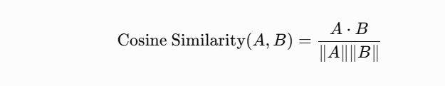
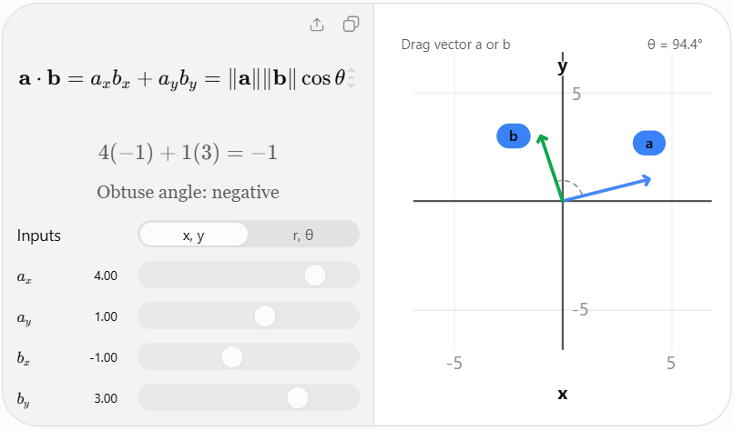
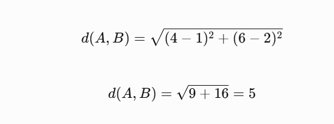

# Topic 4.6 — Vector Similarity Algorithms


### 1. What are vector similarity algorithms?

In Topic 4.5, we learned that semantic similarity compares the meaning of two texts using their embeddings.

But here's an important question:

How does a computer calculate whether two vectors are similar?

It uses mathematical algorithms called vector similarity or distance measures.

For example:

```
Vector A = [1, 2, 3]
Vector B = [2, 3, 4]
```

An algorithm calculates how closely these vectors are related.

There are several commonly used methods.

### 2. Four important algorithms

#### A. Cosine Similarity

Cosine similarity measures the angle between two vectors.



Typical range:

- `1` → same direction.
- `0` → perpendicular vectors.
- `-1` → opposite directions.

Commonly used for text embeddings

Why? It focuses on vector direction rather than vector magnitude.

#### B. Dot Product

Dot product multiplies corresponding vector values and adds the results.

For example:

```
A = [1, 2, 3]
B = [4, 5, 6]

Dot Product = (1 × 4) + (2 × 5) + (3 × 6)
            = 4 + 10 + 18
            = 32
```

It measures alignment while also being affected by vector magnitudes.



Important: Dot product and cosine similarity are closely related, but they are not identical. If both vectors are normalized to length 1, their dot product equals their cosine similarity.

#### C. Euclidean Distance (L2 Distance)

Euclidean distance measures the straight-line distance between two points in vector space.

For example:

```
A = [1, 2]
B = [4, 6]
```



Interpretation:

- Smaller distance → vectors are closer.
- Larger distance → vectors are farther apart.

Unlike similarity scores, lower distance generally means greater similarity.

#### D. Manhattan Distance (L1 Distance)

Manhattan distance calculates the sum of the absolute differences between corresponding vector values.

Using the same vectors:

```
A = [1, 2]
B = [4, 6]

Distance = |4 - 1| + |6 - 2|
         = 3 + 4
         = 7
```

It measures distance by moving along individual dimensions rather than taking the straight-line path.

### 3. Comparison of algorithms

| Algorithm          | Measures                    | Better result |
| ------------------ | --------------------------- | ------------- |
| Cosine Similarity  | Angle / direction           | Higher        |
| Dot Product        | Alignment and magnitude     | Higher        |
| Euclidean Distance | Straight-line distance      | Lower         |
| Manhattan Distance | Sum of absolute differences | Lower         |

### 4. Which algorithm should we use in our Career Knowledge Search Engine?

For text-based semantic search, cosine similarity is a useful starting point.

However, the best choice depends on the embedding model, whether vectors are normalized, and the vector database's supported distance operators.

For example, pgvector supports:

- Cosine distance
- L2 distance
- Inner product (dot product)

We'll use these concepts when we reach PostgreSQL and pgvector.

One important distinction: Similarity algorithms compare vectors. They don't understand Java, Spring Boot, or career advice themselves. The embedding model creates the meaningful numerical representation; the algorithm compares it.

