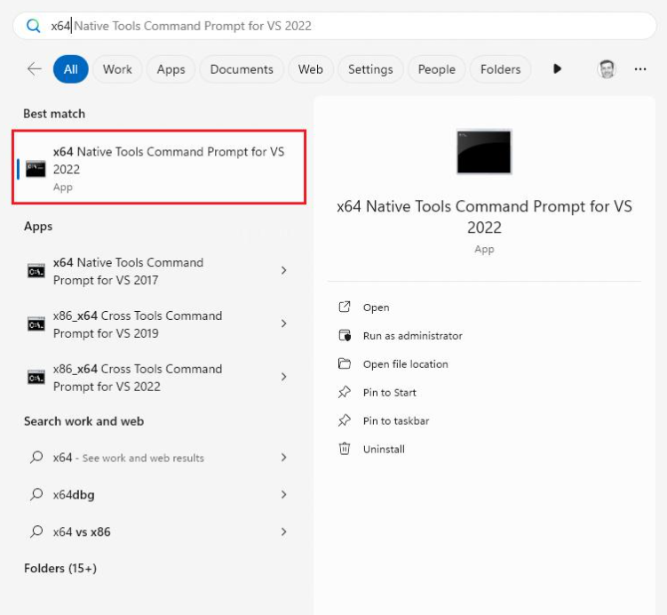

Your PostgreSQL database is working, but **the pgvector extension is not installed on your PostgreSQL server**.

There are two separate operations:

1. **Install pgvector:** Make the extension available to PostgreSQL on your computer.
2. **Enable pgvector:** Run `CREATE EXTENSION vector;` inside your database.

You attempted step 2 before completing step 1.

Let's fix it on Windows.

## **Step 1 — Identify your PostgreSQL version**

Open pgAdmin's Query Tool and execute:

```
SELECT version();
```

You should see something similar to:

```
PostgreSQL 17.x ...
```

Also execute:

```
SHOW data_directory;
```

This tells us where PostgreSQL stores its database files.

## **Step 2 — Install the required Windows build tools**

The official pgvector project does not provide an official Windows installer. For a native PostgreSQL installation, we'll compile pgvector using Microsoft's C++ build tools.


You need:

1. **Git for Windows:** [Download Git](https://git-scm.com/downloads/win?utm_source=chatgpt.com).
2. **Visual Studio 2022 Build Tools:** [Download Build Tools](https://visualstudio.microsoft.com/downloads/?utm_source=chatgpt.com).

During the Visual Studio installation:

- Select **Desktop development with C++**.
- Make sure the MSVC x64/x86 build tools are selected.
- Install the tools.

You do not need the full Visual Studio IDE for this.

## **Step 3 — Open the correct command prompt**

After installation:

1. Open the Windows Start menu.
2. Search for `x64 Native Tools Command Prompt for VS 2022`.
3. Right-click it.
4. Select **Run as administrator**.


This is important: use the x64 prompt, not an ordinary Command Prompt.

## **Step 4 — Build and install pgvector**

Suppose your PostgreSQL installation is:

```
C:\Program Files\PostgreSQL\17
```

Replace `17` with your actual PostgreSQL major version.

Execute these commands one at a time:

**1. Set PostgreSQL installation directory**

```
set "PGROOT=C:\Program Files\PostgreSQL\17"
```

**2. Navigate to temporary directory**

```
cd %TEMP%
```

**3. Download pgvector source code**

```
git clone --branch v0.8.7 https://github.com/pgvector/pgvector.git
```

**4. Enter the downloaded folder**

```
cd pgvector
```

**5. Compile pgvector**

```
nmake /F Makefile.win
```

**6. Install pgvector into PostgreSQL**

```
nmake /F Makefile.win install
```

The last command copies the required extension files into your PostgreSQL installation.


Important

Do not execute Step 4 until we've confirmed your actual PostgreSQL version and installation directory. The example above assumes PostgreSQL 17.

## **Step 5 — Enable pgvector in pgAdmin**

Once the installation succeeds:

Return to pgAdmin and execute:

```
CREATE EXTENSION IF NOT EXISTS vector;
```

Then verify:

```
SELECT extname, extversion
FROM pg_extension
WHERE extname = 'vector';
```

You should see `vector` and its installed version.

## **Let's first confirm your PostgreSQL installation**

Before you start installing build tools, send me the results of these two queries:

```
SHOW server_version;
```

```
SHOW data_directory;
```

I'll use those results to give you the exact `PGROOT` path and commands for your machine.

**We'll get pgvector working without unnecessarily reinstalling PostgreSQL or disturbing your existing databases.** 😊