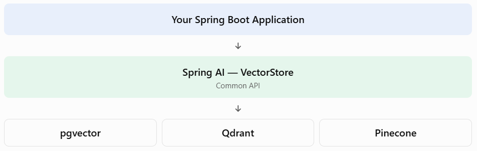

# Topic 4.10 — Understanding Vector Databases

## 1. Why are there multiple vector databases?

Different applications have different requirements.

For example:

- A college project may need a simple database that works with existing PostgreSQL.
- A large AI company may need a highly scalable, managed vector database.
- A developer experimenting locally may want something lightweight and easy to run.

There is no single vector database that is best for every situation.

## 2. Popular vector database options

Here are six important options to understand.

### 1. PostgreSQL with pgvector
- Open-source PostgreSQL extension.
- Stores ordinary relational data and embeddings together.
- Supports vector similarity search.
- Excellent when your application already uses PostgreSQL.

  Recommended for your project

### 2. Pinecone
- Fully managed vector database service.
- Designed for production AI applications.
- You don't need to manage the database infrastructure yourself.
- Useful when you want a managed service rather than operating your own database.

### 3. Qdrant
- Built specifically for vector search.
- Supports metadata filtering.
- Can run locally or as a managed service.
- Useful for semantic search and recommendation systems.

### 4. Chroma
- Developer-friendly and relatively simple to get started with.
- Popular for prototypes and experimentation.
- Useful when learning vector search concepts.

### 5. Weaviate
- Supports vector search and metadata filtering.
- Provides hybrid search capabilities.
- Useful for more feature-rich AI search applications.

### 6. Milvus
- Designed for large-scale vector search.
- Suitable for applications with very large embedding collections.
- Useful when scalability and high-volume retrieval are important.

Spring AI supports integrations with these and several other vector stores.


## 3. Comparison at a glance

| Database              | Main strength               | Typical use                      |
| --------------------- | --------------------------- | -------------------------------- |
| PostgreSQL + pgvector | Relational + vector storage | Existing PostgreSQL applications |
| Pinecone              | Managed service             | Managed production search        |
| Qdrant                | Vector search and filtering | Semantic search                  |
| Chroma                | Easy experimentation        | Learning and prototypes          |
| Weaviate              | Rich search capabilities    | AI search applications           |
| Milvus                | Large-scale vector search   | Large embedding collections      |

Remember: these are general strengths, not strict limitations. Actual performance depends on configuration, workload, infrastructure, and data size.

## 4. How does Spring AI work with different databases?

This is an important concept!

Spring AI provides an abstraction called `VectorStore`.

Instead of writing your application around one database's native API, you can program against the common `VectorStore` interface.



For example, your application can use:

```
vectorStore.add(documents);

List<Document> results =
        vectorStore.similaritySearch("Java backend development");
```

The application uses the same general API regardless of the selected implementation.

Does this mean changing databases requires absolutely no code changes?

No. You may need to change dependencies, configuration, credentials, database setup, and database-specific features. But the common application logic can remain largely the same.


## 5. Which database should we choose for your project?

Your AI Skill and Career Management Platform already uses PostgreSQL.

I recommend PostgreSQL + pgvector.

Why?

1. You already have PostgreSQL in your technology stack.
2. You can store student information and vector embeddings in the same database.
3. You can combine SQL queries with semantic search.
4. You avoid introducing another database service while learning.
5. Spring AI provides a `PgVectorStore` implementation.

One more important distinction: Spring AI's `SimpleVectorStore` is useful for demonstrations and testing, but it is not designed for production.

