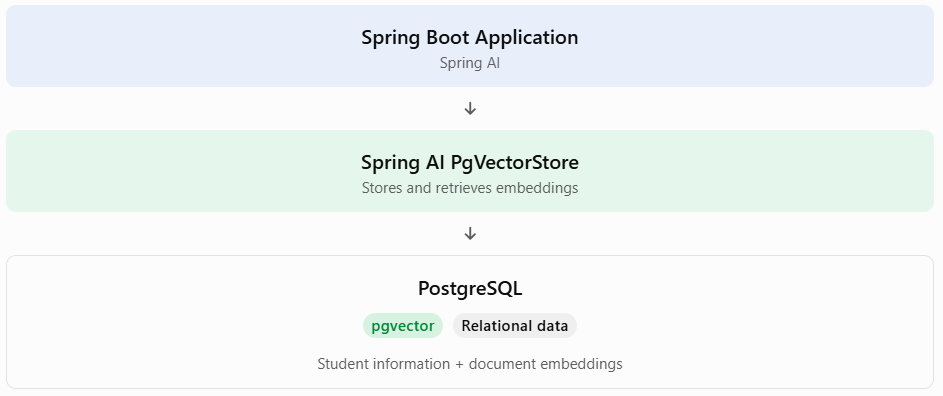

# **Topic 4.11 — PostgreSQL and pgvector Setup**

Part B — Understanding Vector Databases

In this topic, we'll connect PostgreSQL with Spring AI so that our application can store embeddings and perform semantic searches.

We'll use your existing environment:

- Java 21
- Spring Boot 4.1.1
- Spring AI 2.0.1
- Maven
- IntelliJ IDEA
- PostgreSQL
- Gemini

## **1. Understand what we're setting up**

You already have PostgreSQL installed. However, PostgreSQL does not automatically support vector operations just because it is installed.

We need **pgvector**, a PostgreSQL extension.


Spring AI uses `PgVectorStore` to communicate with PostgreSQL's vector capabilities.


## **2. Step 1 — Enable pgvector in PostgreSQL**

First, open **pgAdmin**.

1. Open pgAdmin on your Windows computer.
2. Connect to your PostgreSQL server.
3. Select the database that your Spring AI application will use.
4. Open its **Query Tool**.

Now execute these SQL commands:

```
CREATE EXTENSION IF NOT EXISTS vector;

CREATE EXTENSION IF NOT EXISTS hstore;

CREATE EXTENSION IF NOT EXISTS "uuid-ossp";
```

**Why do we need these extensions?**

| Extension   | Purpose                                |
| ----------- | -------------------------------------- |
| `vector`    | Stores and searches embedding vectors. |
| `hstore`    | Provides key-value storage support.    |
| `uuid-ossp` | Generates UUID values.                 |

Spring AI's PgVectorStore documentation lists these as required database extensions.


### **3. Verify the installation**

After executing the commands, run:

```
SELECT extname, extversion
FROM pg_extension
WHERE extname IN ('vector', 'hstore', 'uuid-ossp');
```

You should see all three extensions listed.

Expected result

Illustrative output — exact extension versions may differ.

| extname   | extversion        |
| --------- | ----------------- |
| vector    | Installed version |
| hstore    | Installed version |
| uuid-ossp | Installed version |

**Important:** There is a difference between installing pgvector on your PostgreSQL server and enabling it inside a particular database. The SQL command enables it in the database you're currently connected to. If `vector` is unavailable, the pgvector extension package must first be installed on the PostgreSQL server.

> if this error occurs then steps to resolve the issue
```
ERROR:  extension "vector" is not available
HINT:  The extension must first be installed on the system where PostgreSQL is running. 
SQL state: 0A000
Now provide me the steps to resolve this issue.
```
The solutions:
[Click me](./Error1.md)

> if this type of error is shown then follow this steps
```
C:\Users\user\AppData\Local\Temp\pgvector>nmake /F Makefile.win install

Microsoft (R) Program Maintenance Utility Version 14.52.37029.0
Copyright (C) Microsoft Corporation.  All rights reserved.

        copy vector.dll "C:\Program Files\PostgreSQL\18\lib"
Access is denied.
        0 file(s) copied.
NMAKE : fatal error U1077: 'copy vector.dll "C:\Program Files\PostgreSQL\18\lib"' : return code '0x1'
Stop.
```
[Click me](./Error2.md)

## **Step 6 — Enable the PostgreSQL extensions**

Open pgAdmin → select your Spring AI database → Query Tool.

Execute these commands:

```
CREATE EXTENSION IF NOT EXISTS vector;

CREATE EXTENSION IF NOT EXISTS hstore;

CREATE EXTENSION IF NOT EXISTS "uuid-ossp";
```

These enable the extensions inside your selected database.

## **Step 7 — Verify all three extensions**

Execute:

```
SELECT extname, extversion
FROM pg_extension
WHERE extname IN ('vector', 'hstore', 'uuid-ossp');
```

Expected result

You should see three rows:

| Extension | Purpose                              |
| --------- | ------------------------------------ |
| vector    | Vector storage and similarity search |
| hstore    | Key-value storage                    |
| uuid-ossp | UUID generation                      |

## **Step 8 — Test vector storage**

Let's confirm PostgreSQL can actually store vectors.

Run:

```
CREATE TABLE vector_test (
    id SERIAL PRIMARY KEY,
    content TEXT,
    embedding VECTOR(3)
);
```

Now insert a sample vector:

```
INSERT INTO vector_test (content, embedding)
VALUES (
    'Java backend development',
    '[0.1, 0.2, 0.3]'
);
```

Retrieve it:

```
SELECT * FROM vector_test;
```

You should see:

- `id`: 1
- `content`: Java backend development
- `embedding`: `[0.1,0.2,0.3]`


## Step 9: Add the Spring AI PgVectorStore dependency**

Our goal is to let Spring Boot perform these operations through Java instead of manually writing SQL:

- Add documents and their embeddings.
- Search for semantically similar documents.
- Retrieve matching documents.
- Apply metadata filters.

### **A. Add these two dependencies to&#x20;**`pom.xml`

Open your existing Spring AI project in IntelliJ IDEA.

Inside the `<dependencies>` section, add:

```
<!-- PostgreSQL Vector Store -->
<dependency>
    <groupId>org.springframework.ai</groupId>
    <artifactId>spring-ai-starter-vector-store-pgvector</artifactId>
</dependency>

<!-- Google GenAI Embedding Model -->
<dependency>
    <groupId>org.springframework.ai</groupId>
    <artifactId>spring-ai-starter-model-google-genai-embedding</artifactId>
</dependency>
```

These are the Spring AI 2.0.1 starter artifact names.
docs.spring.io+2

**Why do we need two dependencies?**

| Dependency                     | Responsibility                                       |
| ------------------------------ | ---------------------------------------------------- |
| PgVectorStore starter          | Connects Spring AI to PostgreSQL vector storage.     |
| Google GenAI Embedding starter | Generates embeddings using Google's embedding model. |

Remember: Gemini's chat model generates responses, while the embedding model converts text into vectors. They perform different jobs.

### **B. Reload Maven**

In IntelliJ IDEA:

1. Open the Maven tool window.
2. Click **Reload All Maven Projects**.
3. Wait for Maven to download the dependencies.
4. Check that there are no dependency errors.

### **C. Verify your dependencies**

Your existing project should already contain:

- Spring Web
- PostgreSQL Driver
- Spring AI Google GenAI chat starter
- Spring AI JDBC chat memory dependencies (if used in your project)

Keep those dependencies. We are adding the two new starters, not replacing your existing setup.


## **Step 10 — Configure&#x20;**`application.properties`

Open IntelliJ IDEA and navigate to:

`src/main/resources/application.properties`

We'll configure three things:

1. PostgreSQL connection.
2. Google embedding model.
3. PgVectorStore initialization.

### **A. PostgreSQL configuration**

You probably already have these properties from your previous Spring Boot projects.

Keep your existing database credentials and add or verify:

```
spring.datasource.url=jdbc:postgresql://localhost:5432/YOUR_DATABASE
spring.datasource.username=YOUR_USERNAME
spring.datasource.password=YOUR_PASSWORD

spring.datasource.driver-class-name=org.postgresql.Driver
```

Replace the placeholders with your actual database details. Don't share your password here.

### **B. Google Gemini embedding configuration**

Add:

```
spring.ai.google.genai.embedding.api-key=${GEMINI_API_KEY}

spring.ai.google.genai.embedding.text.model=text-embedding-004
```

**What does this do?**

- `api-key`: Authenticates your application with Google's Gemini Developer API.
- `text.model`: Selects the embedding model that converts text into numerical vectors.

If your existing Google GenAI chat configuration already provides the shared API key, you can reuse that configuration rather than maintaining duplicate credentials.


Make sure `GEMINI_API_KEY` is defined in your IntelliJ Run Configuration environment variables.

### **C. PgVectorStore configuration**

Add:

```
spring.ai.vectorstore.pgvector.initialize-schema=true

spring.ai.vectorstore.pgvector.distance-type=COSINE_DISTANCE

spring.ai.vectorstore.pgvector.index-type=HNSW
```

Let's understand these properties:

| Property                        | Purpose                                                            |
| ------------------------------- | ------------------------------------------------------------------ |
| `initialize-schema=true`        | Creates the required vector store table and schema if needed.      |
| `distance-type=COSINE_DISTANCE` | Uses cosine distance for similarity comparisons.                   |
| `index-type=HNSW`               | Uses an approximate nearest-neighbor index for efficient searches. |

**Important:** We're deliberately not specifying the vector dimensions yet. Spring AI can obtain the dimensions from the configured `EmbeddingModel`. This avoids accidentally creating a table with the wrong vector size.


## **Step 11 — Start your Spring Boot application**

Save the properties and run your application from IntelliJ IDEA.

If everything is configured correctly:

- Spring Boot should connect to PostgreSQL.
- Google embedding model auto-configuration should initialize.
- PgVectorStore should create its `vector_store` table.

You can verify the table using pgAdmin:

```
SELECT table_name
FROM information_schema.tables
WHERE table_name = 'vector_store';
```


Expected result

`vector_store`

> If this error occurs then:
```
ERROR: column cannot have more than 2000 dimensions for hnsw index
```
[Click me](./Error3.md)

> If this error occurs then:
```
2026-11-18T16:30:06.716+02:00 ERROR 26712 --- [Phase4] [nio-8084-exec-2] o.a.c.c.C.[.[.[/].[dispatcherServlet]    : Servlet.service() for servlet [dispatcherServlet] in context with path [] threw exception [Request processing failed: com.google.genai.errors.ClientException: 404 . models/text-embedding-004 is not found for API version v1beta, or is not supported for embedContent. Call ModelService.ListModels to see the list of available models and their supported methods.] with root cause
```
[Click me](./Error4.md)


# **2. Next: Verify Spring AI VectorStore**

Before we move into RAG, let's perform a small practical experiment.

Our objective is to insert career-related documents into PostgreSQL using Java rather than manually writing SQL.

This is directly related to your AI Skill and Career Management Platform.

### **Step 1 — Create a service class**

In IntelliJ IDEA:

1. Open `src/main/java`.
2. Navigate to your main application package.
3. Create a package named `service`.
4. Create a Java class named `CareerKnowledgeService`.

Add this code:

```

package com.example.Phase4.service;

import org.springframework.ai.document.Document;
import org.springframework.ai.vectorstore.VectorStore;
import org.springframework.stereotype.Service;

import java.util.List;
import java.util.Map;

@Service
public class CareerKnowledgeService {

    private final VectorStore vectorStore;

    public CareerKnowledgeService(VectorStore vectorStore) {
        this.vectorStore = vectorStore;
    }

    public void addCareerDocuments() {

        List<Document> documents = List.of(

            new Document(
                "Spring Boot is a Java framework used to build REST APIs and backend applications.",
                Map.of("category", "backend", "technology", "Spring Boot")
            ),

            new Document(
                "React is a JavaScript library used to build interactive user interfaces.",
                Map.of("category", "frontend", "technology", "React")
            ),

            new Document(
                "Java is a programming language widely used for enterprise backend development.",
                Map.of("category", "backend", "technology", "Java")
            )
        );

        vectorStore.add(documents);
    }
}

```

### **Step 2 — Understand the important code**

**1.&#x20;**`VectorStore`

```
private final VectorStore vectorStore;
```

This is Spring AI's abstraction for interacting with vector databases.

We don't need to write SQL to insert embeddings.

**2.&#x20;**`Document`

```
new Document(
    "Spring Boot is a Java framework...",
    Map.of("category", "backend")
)
```

A Spring AI `Document` contains:

- Text content.
- Metadata.
- An ID managed by the document/vector-store workflow.

**3.&#x20;**`vectorStore.add(documents)`

```
vectorStore.add(documents);
```

This is the important operation!

Behind the scenes, Spring AI:

1. Receives the documents.
2. Sends their text to the configured embedding model.
3. Receives the generated vectors.
4. Stores the documents, vectors, and metadata in PostgreSQL.

You don't need to manually generate embeddings for this operation.

## **3. Step 3 — Create a REST controller**

Create another package named `controller`.

Create `CareerKnowledgeController.java`:

```

package com.example.Phase4.controller;

import com.example.Phase4.service.CareerKnowledgeService;
import org.springframework.web.bind.annotation.PostMapping;
import org.springframework.web.bind.annotation.RequestMapping;
import org.springframework.web.bind.annotation.RestController;

@RestController
@RequestMapping("/api/career")
public class CareerKnowledgeController {

    private final CareerKnowledgeService careerKnowledgeService;

    public CareerKnowledgeController(
            CareerKnowledgeService careerKnowledgeService) {
        this.careerKnowledgeService = careerKnowledgeService;
    }

    @PostMapping("/documents")
    public String addDocuments() {

        careerKnowledgeService.addCareerDocuments();

        return "Career documents inserted successfully!";
    }
}

```

## **4. Step 4 — Test using Postman**

Start your Spring Boot application.

Send this request:

POST

`http://localhost:8080/api/career/documents`

Expected response:

```
Career documents inserted successfully!
```

Then verify your PostgreSQL table:

```
SELECT id, content, metadata
FROM vector_store;
```

You should see three documents with their metadata and generated embeddings stored in the vector store.

**Note:** If you call this endpoint multiple times, it may insert duplicate documents because this example creates new document IDs on each call. For now, call it once.


##  Performing Similarity Searches Using SQL**

### **Step 1: Understand the SQL query**

Remember our test table?

```
CREATE TABLE vector_test (
    id SERIAL PRIMARY KEY,
    content TEXT,
    embedding VECTOR(3)
);
```

And we inserted:

```
INSERT INTO vector_test (content, embedding)
VALUES
('Java backend development', '[0.1, 0.2, 0.3]');
```

Now let's insert two more records so we have multiple vectors to compare.

Execute this in pgAdmin:

```
INSERT INTO vector_test (content, embedding)
VALUES
('Frontend development with React', '[0.8, 0.2, 0.1]'),
('Python programming', '[0.2, 0.3, 0.4]');
```

### **Step 2: Perform a cosine-distance search**

Execute:

```
SELECT
    id,
    content,
    embedding <=> '[0.1, 0.2, 0.3]' AS distance
FROM vector_test
ORDER BY embedding <=> '[0.1, 0.2, 0.3]'
LIMIT 3;
```


Important operator

`<=>`


This is pgvector's **cosine distance operator**.

Here's what each part does:

| SQL                 | Meaning                           |
| ------------------- | --------------------------------- |
| `embedding`         | Stored document vector            |
| `<=>`               | Calculates cosine distance        |
| `'[0.1, 0.2, 0.3]'` | Example query vector              |
| `ORDER BY`          | Sorts by distance, smallest first |
| `LIMIT 3`           | Returns at most three records     |

### **Step 3: Understand the result**

Your query vector is:

`[0.1, 0.2, 0.3]`

The first stored record has exactly the same vector, so its cosine distance should be `0`.

**Expected ranking (illustrative)**

**Java backend development**

Closest

Distance: 0 — exact vector match

**Python programming**

Less similar than the exact match

**Frontend development with React**

Less similar than the exact match

Remember: cosine distance is different from cosine similarity.

- Smaller cosine distance = more similar.
- Distance of `0` = identical direction.
- Larger distance = less similar.


## **Topic 4.11 — Step 4: Semantic Similarity Search**

### **1. What are we going to build?**

Imagine a student searches your Career Knowledge Search Engine:

> I want to develop server-side applications using Java.

Your database contains this document:

> Spring Boot is a Java framework used to build REST APIs and backend applications.

Notice that the search query and document don't use exactly the same words. A normal keyword search might struggle, but **semantic search** can identify that they have related meanings.

### **2. How does semantic search work?**

**User query**

"I want to develop server-side applications using Java."

**Gemini Embedding Model**

Converts the query into a 768-dimensional vector.

**PostgreSQL + pgvector**

Compares the query vector with stored document vectors.

**Top-K relevant documents**

Returns the most semantically similar documents.

The important part: Spring AI handles query embedding and vector similarity search for us through `VectorStore`.

### **3. Implement semantic search**

We already have `CareerKnowledgeService`. Let's add a search method to it.

**Open&#x20;**`CareerKnowledgeService.java`**&#x20;and add these imports:**

```
import org.springframework.ai.document.Document;
import org.springframework.ai.vectorstore.SearchRequest;
```

Add this method inside your existing service class:

```
public List<Document> searchCareerDocuments(String query) {

    SearchRequest searchRequest = SearchRequest.builder()
            .query(query)
            .topK(3)
            .build();

    return vectorStore.similaritySearch(searchRequest);
}
```

**Understand the important parts:**

| Code                      | Purpose                              |
| ------------------------- | ------------------------------------ |
| `SearchRequest.builder()` | Creates a search request.            |
| `.query(query)`           | Supplies the user's search text.     |
| `.topK(3)`                | Requests up to 3 relevant documents. |
| `similaritySearch()`      | Performs semantic similarity search. |

The returned `List<Document>` contains the matching documents, including their content and metadata.

### **4. Create a REST endpoint**

Open your existing `CareerKnowlegeController.java` and add this endpoint:

```
@GetMapping("/search")
public List<Document> searchDocuments(
        @RequestParam String query) {

    return careerKnowledgeService.searchCareerDocuments(query);
}
```

Add these imports:

```
import org.springframework.ai.document.Document;
import org.springframework.web.bind.annotation.GetMapping;
import org.springframework.web.bind.annotation.RequestParam;

import java.util.List;
```

### **5. Test using Postman**

Restart your Spring Boot application and send:

```
GET http://localhost:8084/api/career/search?query=I want to develop server-side applications using Java
```

You should receive relevant documents, potentially including the Spring Boot and Java documents.

Try another query:

```
GET http://localhost:8084/api/career/search?query=I want to build interactive websites
```

This should find your React document.

