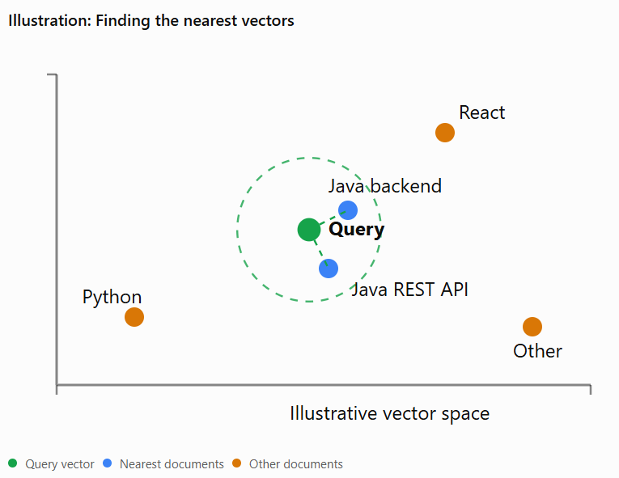
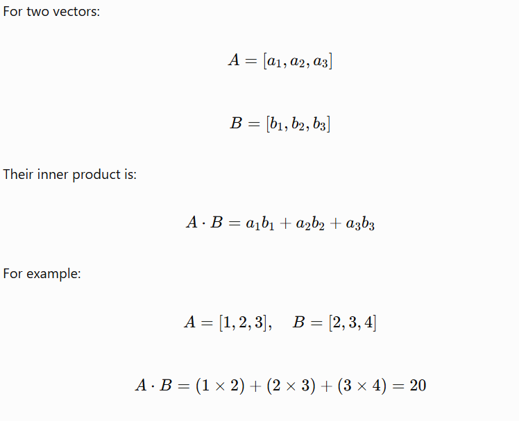

# 4.12 — Similarity Search with pgvector

## 4.12.1 — Understanding Nearest-Neighbor Search
**First, what is a nearest neighbor?**

Imagine you have a student searching:

I want to become a Java backend developer.

Your vector database contains these documents:
1. Java backend development with Spring Boot.
2. React frontend development.
3. Python data science.
4. Building REST APIs using Java.

The database converts the user's query into an embedding vector and compares it with the stored document vectors.

It then identifies the vectors that are closest to the query vector.

This process is called **Nearest-Neighbor Search.**



**Why is nearest-neighbor search useful?**

In modern AI applications, it helps with:

- **RAG:** Retrieve relevant documents before sending context to Gemini.
- **Career platforms:** Find learning resources matching a student's career goal.
- **Chatbots:** Retrieve relevant information from a knowledge base.
- **Recommendation systems:** Find content or products with similar representations.

**Two important types of nearest-neighbor search**

1. **Exact Nearest-Neighbor Search:** Compares the query against all eligible vectors to find the true nearest results.

2. **Approximate Nearest-Neighbor Search (ANN):** Uses indexing techniques to find very close results more efficiently, potentially sacrificing some accuracy.

For large vector collections, ANN can significantly improve search performance. pgvector supports indexing techniques such as HNSW and IVFFlat.


# **4.12.2 — Understanding Distance Operators**

In the previous lesson, we learned that nearest-neighbor search finds vectors closest to a query vector.

But here's an important question:

**How does PostgreSQL decide which vector is closest?**

It uses mathematical calculations called *distance metrics*.

pgvector provides different operators to calculate these distances or similarities.

Today, we'll study three important operators:

1. Cosine distance — `<=>`
2. Euclidean distance — `<->`
3. Negative inner product — `<#>`

## **1. Cosine distance (**`<=>`**)**

Cosine distance measures the difference in direction between two vectors.

It focuses on the angle between vectors rather than their absolute magnitudes.

For semantic search, cosine distance is commonly used because it helps compare the direction of embedding vectors.

**SQL example:**

```
SELECT
    content,
    embedding <=> '[0.1, 0.2, 0.3]' AS distance
FROM vector_test
ORDER BY distance ASC
LIMIT 3;
```

How to interpret the result:

- `0` means the vectors point in the same direction.
- A smaller distance means greater directional similarity.
- A larger distance means less directional similarity.

Remember: identical vectors have cosine distance `0` (assuming non-zero vectors).

## **2. Euclidean distance (**`<->`**)**

Euclidean distance measures the straight-line distance between two points in vector space.

Think about two locations on a map: Euclidean distance measures how far apart they are.


**SQL example:**

```
SELECT
    content,
    embedding <-> '[0.1, 0.2, 0.3]' AS distance
FROM vector_test
ORDER BY distance ASC
LIMIT 3;
```

Interpretation:

- Distance `0` means identical vectors.
- Smaller distance means vectors are closer.
- Larger distance means vectors are farther apart.

Unlike cosine distance, Euclidean distance considers the magnitude and position of the vectors.

## **3. Inner product (**`<#>`**)**

The inner product, also called the dot product, measures how strongly two vectors align, taking their magnitudes into account.



**Important Spring AI / pgvector detail:**

The pgvector `<#>` operator returns the *negative inner product*, not the positive dot product.

Therefore, when searching for the largest inner product, we sort in ascending order.

**SQL example:**

```
SELECT
    content,
    embedding <#> '[0.1, 0.2, 0.3]' AS negative_inner_product
FROM vector_test
ORDER BY negative_inner_product ASC
LIMIT 3;
```

Why ascending?

Because the operator returns negative values. A more negative result represents a larger positive inner product.

## **4. Compare all three operators**

| Operator | Metric                 | Meaning of smaller result         |
| -------- | ---------------------- | --------------------------------- |
| `<=>`    | Cosine distance        | More directionally similar        |
| `<->`    | Euclidean distance     | Physically closer in vector space |
| `<#>`    | Negative inner product | Larger positive dot product       |

**Quick memory trick**

- `<=>` → Compare directions.
- `<->` → Measure straight-line distance.
- `<#>` → Negative dot product; ascending gives highest inner product first.

## **5. When should we use each operator?**

For your AI Skill and Career Management Platform:

- **Cosine distance:** A good default for semantic similarity searches.
- **Euclidean distance:** Useful when the actual geometric distance between embeddings is important.
- **Inner product:** Useful when the embedding model and search configuration are designed around dot-product scoring.

The best metric depends on the embedding model and how its vectors are intended to be compared. Don't assume all three produce the same ranking.
