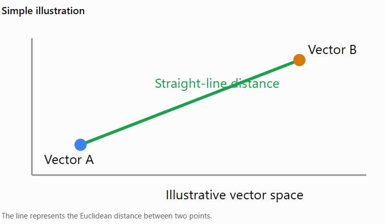
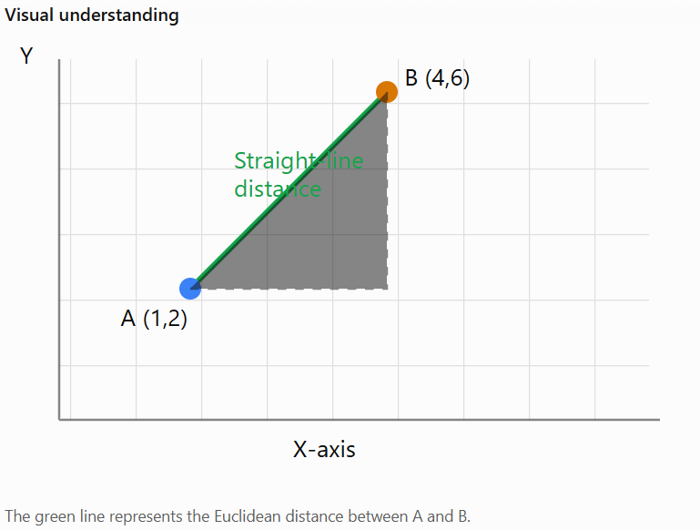
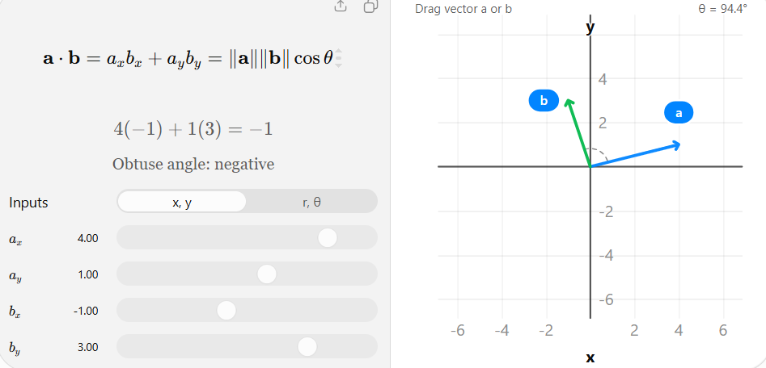

# 4.12 — Similarity Search with pgvector

## 4.12.1 — Understanding Nearest-Neighbor Search
**First, what is a nearest neighbor?**

Imagine you have a student searching:

I want to become a Java backend developer.

Your vector database contains these documents:
1. Java backend development with Spring Boot.
2. React frontend development.
3. Python data science.
4. Building REST APIs using Java.

The database converts the user's query into an embedding vector and compares it with the stored document vectors.

It then identifies the vectors that are closest to the query vector.

This process is called **Nearest-Neighbor Search.**


**Why is nearest-neighbor search useful?**

In modern AI applications, it helps with:

- **RAG:** Retrieve relevant documents before sending context to Gemini.
- **Career platforms:** Find learning resources matching a student's career goal.
- **Chatbots:** Retrieve relevant information from a knowledge base.
- **Recommendation systems:** Find content or products with similar representations.

**Two important types of nearest-neighbor search**

1. **Exact Nearest-Neighbor Search:** Compares the query against all eligible vectors to find the true nearest results.

2. **Approximate Nearest-Neighbor Search (ANN):** Uses indexing techniques to find very close results more efficiently, potentially sacrificing some accuracy.

For large vector collections, ANN can significantly improve search performance. pgvector supports indexing techniques such as HNSW and IVFFlat.


# **4.12.2 — Understanding Distance Operators**

In the previous lesson, we learned that nearest-neighbor search finds vectors closest to a query vector.

But here's an important question:

**How does PostgreSQL decide which vector is closest?**

It uses mathematical calculations called *distance metrics*.

pgvector provides different operators to calculate these distances or similarities.

Today, we'll study three important operators:

1. Cosine distance — `<=>`
2. Euclidean distance — `<->`
3. Negative inner product — `<#>`

## **1. Cosine distance (**`<=>`**)**

Cosine distance measures the difference in direction between two vectors.

It focuses on the angle between vectors rather than their absolute magnitudes.

For semantic search, cosine distance is commonly used because it helps compare the direction of embedding vectors.

**SQL example:**

```
SELECT
    content,
    embedding <=> '[0.1, 0.2, 0.3]' AS distance
FROM vector_test
ORDER BY distance ASC
LIMIT 3;
```

How to interpret the result:

- `0` means the vectors point in the same direction.
- A smaller distance means greater directional similarity.
- A larger distance means less directional similarity.

Remember: identical vectors have cosine distance `0` (assuming non-zero vectors).

## **2. Euclidean distance (**`<->`**)**

Euclidean distance measures the straight-line distance between two points in vector space.

Think about two locations on a map: Euclidean distance measures how far apart they are.



**SQL example:**

```
SELECT
    content,
    embedding <-> '[0.1, 0.2, 0.3]' AS distance
FROM vector_test
ORDER BY distance ASC
LIMIT 3;
```

Interpretation:

- Distance `0` means identical vectors.
- Smaller distance means vectors are closer.
- Larger distance means vectors are farther apart.

Unlike cosine distance, Euclidean distance considers the magnitude and position of the vectors.

## **3. Inner product (**`<#>`**)**

The inner product, also called the dot product, measures how strongly two vectors align, taking their magnitudes into account.


**Important Spring AI / pgvector detail:**

The pgvector `<#>` operator returns the *negative inner product*, not the positive dot product.

Therefore, when searching for the largest inner product, we sort in ascending order.

**SQL example:**

```
SELECT
    content,
    embedding <#> '[0.1, 0.2, 0.3]' AS negative_inner_product
FROM vector_test
ORDER BY negative_inner_product ASC
LIMIT 3;
```

Why ascending?

Because the operator returns negative values. A more negative result represents a larger positive inner product.

## **4. Compare all three operators**

| Operator | Metric                 | Meaning of smaller result         |
| -------- | ---------------------- | --------------------------------- |
| `<=>`    | Cosine distance        | More directionally similar        |
| `<->`    | Euclidean distance     | Physically closer in vector space |
| `<#>`    | Negative inner product | Larger positive dot product       |

**Quick memory trick**

- `<=>` → Compare directions.
- `<->` → Measure straight-line distance.
- `<#>` → Negative dot product; ascending gives highest inner product first.

## **5. When should we use each operator?**

For your AI Skill and Career Management Platform:

- **Cosine distance:** A good default for semantic similarity searches.
- **Euclidean distance:** Useful when the actual geometric distance between embeddings is important.
- **Inner product:** Useful when the embedding model and search configuration are designed around dot-product scoring.

The best metric depends on the embedding model and how its vectors are intended to be compared. Don't assume all three produce the same ranking.


//cosine -similarity
## 4.12.3 — Cosine Distance in Depth
Let's understand cosine distance more deeply because we'll use it frequently in our Career Knowledge Search Engine.
### 1. What exactly is cosine distance?
Cosine distance measures how different the directions of two vectors are.

It is calculated using cosine similarity:
```
Consine Distance=1-Cosine Similarity
```

Cosine similarity measures the cosine of the angle between two vectors.
$$
\text{Cosine Similarity} = \frac{A \cdot B}{\|A\| \|B\|}
$$


Where:
- A = First vector.
- B = Second vector.
- A.B= Dot product.
- ||A|| and ||B||= Vector magnitudes.

### 2. Understand the results
For non-zero vectors, cosine similarity ranges from -1 to 1, and cosine distance ranges from 0 to 2.

|Cosine similarity	|Cosine distance|	Interpretation|
|-------------------|---------------|-----------------|
|1	|0|	Same direction|
|0.8|	0.2	|Highly aligned|
|0.5|	0.5|	Some alignment|
|0|	1	|Perpendicular|
|-1|	2|	Opposite direction|

Remember this relationship

**More similar**
0

**Less similar**
2


Illustrative cosine-distance scale for non-zero vectors.
Important: A cosine distance of 0 means the vectors point in the same direction. They do not necessarily have identical magnitudes.

### 3. Calculate cosine distance with a simple example
Suppose:

$$
 A=[1,0]
$$

$$
 B=[1,0]
$$

Their cosine similarity is:
$$
\frac{1}{1\times1}=1
$$

Therefore:
$$
\text{Distance}=1-1=0
$$

They point in exactly the same direction.

Now consider:
$$
A=[1,0],\quad B=[0,1]
$$

Their dot product is zero, so:
$$
\text{Distance}=1-0=1
$$

They are perpendicular.

### 4. Perform cosine similarity search using SQL
Let's use the `vector_test` table you created earlier.

Step 1: Calculate cosine distance
```
SELECT
    content,
    embedding <=> '[0.1, 0.2, 0.3]' AS cosine_distance
FROM vector_test
ORDER BY cosine_distance ASC;
```

Step 2: Calculate cosine similarity

We can convert cosine distance into cosine similarity:
```
SELECT
    content,
    1 - (embedding <=> '[0.1, 0.2, 0.3]')
        AS cosine_similarity
FROM vector_test
ORDER BY cosine_similarity DESC;
```

Notice the difference:
- Distance: sort ascending `(ASC)`.
- Similarity: sort descending `(DESC)`.
Both queries produce the same ranking for valid non-zero vectors.
5. How does this help our Career Knowledge Platform?
Suppose a student searches:
I want to build REST APIs using Java.

Our application:
1. Converts the query into an embedding using Gemini.
2. PostgreSQL calculates cosine distances against stored embeddings.
3. The closest documents are ranked first.
4. Spring AI returns relevant documents.

This allows us to retrieve relevant career-learning resources even when the wording differs.


//4.12.4 — Euclidean Distance in Depth


# **4.12.4 — Euclidean Distance in Depth**

## **1. What is Euclidean distance?**

Euclidean distance measures the **straight-line distance between two points in vector space**.

Imagine two locations on a map. Euclidean distance tells us how far apart those locations are.

The same concept applies to embedding vectors.

For example, suppose we have two vectors:

$$
 A=[1,2] 
$$

$$
 B=[4,6] 
$$

Euclidean distance calculates the straight-line distance between these two points.



## **2. Mathematical formula**

For two vectors:

$$
A=[a_1,a_2,\ldots,a_n] 
$$

$$
B=[b_1,b_2,\ldots,b_n] 
$$


The Euclidean distance formula is:
$$
d(A, B) = \sqrt{\sum_{i=1}^{n} (a_i - b_i)^2}
$$

In simple terms:

1. Subtract corresponding vector components.
2. Square each difference.
3. Add all squared differences.
4. Calculate the square root.

## **3. Calculate Euclidean distance with an example**

Let's use:

$$
A=[1,2],\quad B=[4,6] 
$$

**Step 1: Subtract corresponding components.**

$$ 
(1-4)=-3 
$$

$$
(2-6)=-4 
$$

**Step 2: Square the differences.**

$$
 (-3)^2=9 
$$

$$
(-4)^2=16 
$$

**Step 3: Add them.**

$$
 9+16=25 
$$

**Step 4: Calculate the square root.**

$$
d(A,B)=\sqrt{25}=5 
$$

**Euclidean distance** = 5

## **4. Euclidean distance in pgvector**

Remember our three pgvector operators?

| Operator | Calculation            |
| -------- | ---------------------- |
| `<=>`    | Cosine distance        |
| `<->`    | Euclidean distance     |
| `<#>`    | Negative inner product |

pgvector uses the `<->` operator to calculate Euclidean distance.

Let's perform a practical SQL experiment.

Execute this in pgAdmin:

```
SELECT
    content,
    embedding <-> '[0.1, 0.2, 0.3]' AS euclidean_distance
FROM vector_test
ORDER BY euclidean_distance ASC
LIMIT 3;
```

**What happens here?**

- `embedding` represents the stored vector.
- `<->` calculates Euclidean distance.
- `ORDER BY ... ASC` puts the closest vectors first.
- `LIMIT 3` returns at most three records.

Unlike cosine distance, Euclidean distance considers both direction and magnitude.

## **5. Cosine distance vs Euclidean distance**

This is an important comparison for your Spring AI journey.

| Cosine distance                          | Euclidean distance              |
| ---------------------------------------- | ------------------------------- |
| Compares vector directions               | Measures straight-line distance |
| Less affected by magnitude               | Affected by magnitude           |
| Range for non-zero vectors: 0 to 2       | Range: 0 to infinity            |
| Smaller means more directionally similar | Smaller means physically closer |

**Important example:**

Consider these vectors:

$$
 A=[1,2] 
$$

$$
B=[2,4] 
$$

They point in the same direction, so their cosine distance is `0`.

However, their Euclidean distance is:

$$
\sqrt{(1-2)^2+(2-4)^2} =\sqrt{5} 
$$

Therefore, their Euclidean distance is approximately `2.236`.

This demonstrates why cosine distance and Euclidean distance can produce different interpretations.

## **6. When is Euclidean distance useful?**

In AI applications, Euclidean distance can be useful when:

- Absolute distances between embeddings matter.
- The embedding model is designed for Euclidean-distance comparisons.
- You want to identify vectors that are geometrically close.

For our Career Knowledge Platform, we should select the distance metric based on the embedding model's intended use and test retrieval quality rather than assuming one metric is always better.

//Inner product 
## 4.12.5 — Inner Product in Depth
Now let's study our third important similarity calculation: **Inner Product (Dot Product).**
### 1. What is Inner Product?
Inner product, also called dot product, is a mathematical operation that multiplies corresponding components of two vectors and adds the results.

Suppose we have:
$$
A=[1,2,3]
$$

$$
B=[4,5,6]
$$

Their inner product is:
$$
A\cdot B=(1\times4)+(2\times5)+(3\times6)
$$

$$
=4+10+18=32
$$

**Inner product** = 32

### 2. Understand it visually
The dot product is also related to the angle between two vectors:



Its mathematical relationship is:
$$
A\cdot B=\|A\|\|B\|\cos(\theta)
$$

Where:
- A and B are vectors.
- ||A|| and ||B||are their magnitudes.
- $\theta$ is the angle between them. A larger positive dot product generally indicates stronger alignment when vector magnitudes are comparable.


### 3. Understand positive, zero and negative inner products
|Inner product	|Meaning|
|--------------|-------|
|Positive|	Vectors point generally in the same direction|
|Zero	|Vectors are perpendicular (for non-zero vectors)|
|Negative|	Vectors point generally in opposite directions|

For example:
$$
A=[1,0],\quad B=[0,1]
$$

$$
A\cdot B=(1\times0)+(0\times1)=0
$$

These vectors are perpendicular.
### 4. How does pgvector calculate inner product?
Remember the important detail from 4.12.2:

pgvector uses this operator:
```
<#>
```

However, it returns the **negative inner product**, not the ordinary positive dot product.

For example:
$$
A\cdot B=32
$$

The pgvector operator returns:
$$
-32
$$
Why?

Because PostgreSQL's index scan ordering works with ascending order for this operator. Returning the negative value allows the largest positive inner products to appear first when sorting in ascending order.

### 5. Practical SQL example
Open pgAdmin and execute:
```
SELECT
    content,
    embedding <#> '[0.1, 0.2, 0.3]' AS negative_inner_product
FROM vector_test
ORDER BY negative_inner_product ASC
LIMIT 3;
```

This query:
1. Compares each stored vector against the query vector.
2. Calculates negative inner products.
3. Sorts the results in ascending order.
4. Returns at most three records.

To display the ordinary positive inner product instead:
```
SELECT
    content,
    -(embedding <#> '[0.1, 0.2, 0.3]')
        AS inner_product
FROM vector_test
ORDER BY embedding <#> '[0.1, 0.2, 0.3]' ASC
LIMIT 3;
```

Notice that we negate the result for display, but still sort using the original operator.
### 6. When is Inner Product useful in AI?
Inner product is useful for:
- Ranking documents by dot-product similarity.
- Recommendation systems.
- Neural-network calculations.
- Embedding retrieval when the model is designed for dot-product scoring.

One important distinction: inner product considers vector magnitude as well as direction. Therefore, a large dot product doesn't always mean two vectors have the closest directions.

//4.12.6 — Ordering Search Results by Similarity

## **4.12.6 — Ordering Search Results by Similarity**

### **1. Why do we need to order search results?**

Imagine your Career Knowledge Search Engine contains 1,000 documents.

A student searches:

> I want to become a Java backend developer.

Your application converts this query into an embedding and compares it with stored document embeddings.

The database may find several relevant documents:

- Java backend development
- Spring Boot REST API development
- React frontend development
- Python programming
- Microservices architecture

But which documents should appear first?

We need to **order the search results according to their similarity to the query** so the most relevant documents appear first.

### **2. Ordering with cosine distance**

Remember:

- `<=>` calculates cosine distance.
- Smaller cosine distance means greater similarity.
- Therefore, use `ASC` (ascending order).

```
SELECT
    content,
    embedding <=> '[0.1, 0.2, 0.3]' AS distance
FROM vector_test
ORDER BY embedding <=> '[0.1, 0.2, 0.3]' ASC;
```

Example interpretation:

| Document                   | Cosine distance |
| -------------------------- | --------------- |
| Java backend development   | 0.05            |
| Spring Boot REST API       | 0.12            |
| Python programming         | 0.35            |
| React frontend development | 0.80            |

The Java backend document appears first because its cosine distance is the smallest.

### **3. Ordering with different distance operators**

The ordering direction depends on the operator you're using.

| Operator | Calculation            | Correct ordering |
| -------- | ---------------------- | ---------------- |
| `<=>`    | Cosine distance        | `ASC`            |
| `<->`    | Euclidean distance     | `ASC`            |
| `<#>`    | Negative inner product | `ASC`            |

Why do all three use ascending order?

- Cosine distance: smaller means more similar.
- Euclidean distance: smaller means closer.
- Negative inner product: more negative means a larger positive inner product.

**Important:** When using `<#>`, don't accidentally sort by the displayed positive inner product in ascending order. That would reverse the ranking.

### **4. Practical SQL examples**

Let's use your `vector_test` table.

**A. Cosine distance**

```
SELECT
    content,
    embedding <=> '[0.1, 0.2, 0.3]' AS cosine_distance
FROM vector_test
ORDER BY embedding <=> '[0.1, 0.2, 0.3]' ASC;
```

**B. Euclidean distance**

```
SELECT
    content,
    embedding <-> '[0.1, 0.2, 0.3]' AS euclidean_distance
FROM vector_test
ORDER BY embedding <-> '[0.1, 0.2, 0.3]' ASC;
```

**C. Inner product**

```
SELECT
    content,
    -(embedding <#> '[0.1, 0.2, 0.3]') AS inner_product
FROM vector_test
ORDER BY embedding <#> '[0.1, 0.2, 0.3]' ASC;
```

All three queries rank results using a different mathematical measure. Their numerical scores are not directly interchangeable.

### **5. How does this connect to Spring AI?**

In your Spring AI application, you don't normally need to write these SQL queries manually for every search.

Spring AI's `VectorStore` provides a common API:

```
SearchRequest searchRequest = SearchRequest.builder()
        .query("I want to become a Java backend developer")
        .topK(3)
        .build();

List<Document> results =
        vectorStore.similaritySearch(searchRequest);
```

Spring AI handles the vector search through the configured vector store.

Behind the scenes, pgvector performs similarity calculations and retrieves the relevant documents. Your application receives the results to provide as context to Gemini.

This is useful in your Career Knowledge Search Engine because students can search using natural language rather than remembering exact document keywords.


//Limiting results with Top-K and Filtering results using metadata.

## **4.12.7 — Limiting Results with Top-K**

### **1. What is Top-K?**

Top-K means retrieving only the K most relevant documents from a vector database.

Suppose your database has 10,000 documents. A student searches:

> I want to learn Spring Boot REST APIs.

Instead of returning all 10,000 documents, we might retrieve only the best 3 matches.

**Example: Top-K = 3**

1

**Spring Boot REST API**

Cosine distance: 0.05

2

**Java Backend Development**

Cosine distance: 0.12

3

**Building Microservices**

Cosine distance: 0.18

Only the three highest-ranked results are returned.

### **2. Top-K in PostgreSQL**

We use SQL's `LIMIT` clause:

```
SELECT
    content,
    embedding <=> '[0.1, 0.2, 0.3]' AS distance
FROM vector_test
ORDER BY embedding <=> '[0.1, 0.2, 0.3]' ASC
LIMIT 3;
```

- `ORDER BY` ranks the documents.
- `ASC` puts the smallest cosine distance first.
- `LIMIT 3` returns at most three rows.

### **3. Top-K in Spring AI**

Spring AI provides the `.topK()` method through `SearchRequest`.

```
SearchRequest searchRequest = SearchRequest.builder()
        .query("I want to learn Spring Boot REST APIs")
        .topK(3)
        .build();

List<Document> results =
        vectorStore.similaritySearch(searchRequest);
```

Here, Spring AI asks the vector store for up to three matching documents.

### **4. Why is Top-K important in RAG?**

Remember our RAG flow:

1. Student asks a question.
2. Application converts the question into an embedding.
3. Vector database retrieves relevant documents.
4. Top-K controls how many documents are retrieved.
5. Retrieved documents are provided to Gemini as context.
6. Gemini generates an answer.

Top-K helps control context size, token usage, and retrieval latency. But remember: Top-K returns the best available matches, not necessarily documents that are all genuinely relevant.

## **4.12.8 — Filtering Results Using Metadata**

### **1. What is metadata?**

Metadata is additional information attached to a document.

For example, imagine your Career Knowledge Search Engine stores these documents:

| Document         | Category | Level    | Technology |
| ---------------- | -------- | -------- | ---------- |
| Java REST API    | Backend  | Beginner | Java       |
| React Components | Frontend | Beginner | React      |
| Spring Security  | Backend  | Advanced | Java       |
| Python Basics    | Backend  | Beginner | Python     |

The document content contains the actual information. Metadata describes the document.

In Spring AI, a `Document` can contain both content and metadata.

### **2. Why do we need metadata filtering?**

Suppose a student searches:

> I want to learn backend development.

The vector database might find relevant documents about Java, Python, and other technologies.

But suppose the student specifically wants beginner-level Java backend material.

We can filter the results using:

- Category = Backend
- Level = Beginner
- Technology = Java

This prevents unrelated documents from being considered, even if their embeddings are semantically similar.

### **3. Adding metadata using Spring AI**

Let's create a document with metadata.

```
import org.springframework.ai.document.Document;
import java.util.Map;

Document document = new Document(
        "Learn how to build REST APIs using Spring Boot.",
        Map.of(
                "category", "backend",
                "level", "beginner",
                "technology", "java"
        )
);

vectorStore.add(List.of(document));
```

Explanation:

- First argument: actual document content.
- Second argument: metadata represented as key-value pairs.
- `vectorStore.add()`: stores the document and its embedding in the vector store.

You can attach different metadata to different documents.

### **4. Filtering using PostgreSQL**

In pgvector, Spring AI stores document metadata in a JSONB column.

You can understand the filtering concept using ordinary PostgreSQL SQL:

```
SELECT
    content,
    metadata
FROM vector_store
WHERE metadata->>'category' = 'backend'
  AND metadata->>'level' = 'beginner';
```

Here:

- `metadata->>'category'` extracts the category as text.
- `metadata->>'level'` extracts the level.
- `WHERE` selects documents matching both conditions.

This is a metadata filter, not a vector similarity search. We can combine metadata filtering with similarity search.

### **5. Metadata filtering using Spring AI**

Spring AI supports metadata filters through `SearchRequest`.

**Example 1: String-based filtering**

```
SearchRequest searchRequest = SearchRequest.builder()
        .query("I want to learn backend development")
        .topK(5)
        .filterExpression(
                "category == 'backend' && level == 'beginner'"
        )
        .build();

List<Document> results =
        vectorStore.similaritySearch(searchRequest);
```

This tells Spring AI:

1. Search for documents semantically related to backend development.
2. Only consider documents whose category is `backend`.
3. Only consider documents whose level is `beginner`.
4. Return up to five matching documents.

**Example 2: Using FilterExpressionBuilder**

You can also build filters programmatically:

```
import org.springframework.ai.vectorstore.filter.FilterExpressionBuilder;

FilterExpressionBuilder b = new FilterExpressionBuilder();

var filter = b.and(
        b.eq("category", "backend"),
        b.eq("level", "beginner")
).build();

SearchRequest searchRequest = SearchRequest.builder()
        .query("I want to learn backend development")
        .topK(5)
        .filterExpression(filter)
        .build();

List<Document> results =
        vectorStore.similaritySearch(searchRequest);
```

The `FilterExpressionBuilder` is useful when filters become more complex. It supports conditions such as equality, greater than, less than, `AND`, `OR`, and `IN`.


### **6. How Top-K and metadata filtering work together**

**Student Query**

Find beginner Java backend tutorials

**Metadata Filtering**

category = backend, level = beginner, technology = java

**Similarity Search**

Rank eligible documents by semantic similarity

**Top-K Results**

Return up to the five best matches

**Gemini**

Generates an answer using retrieved documents

The order above is a conceptual explanation: the metadata filter restricts eligible documents, similarity ranks those documents, and Top-K limits the returned results.

**A real-world use case in your project:** You could filter career knowledge by skill category, experience level, technology, course semester, or document owner. Metadata filters can also help enforce data separation, but authorization must still be enforced by your backend—not trusted to a user-provided filter.
