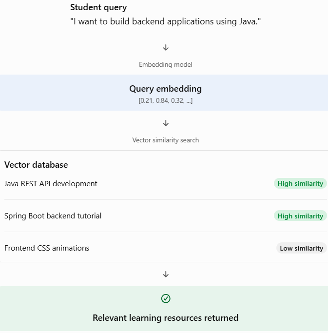

# Topic 4.8 — Introduction to Vector Databases

## 1. What is a Vector Database?

Let's start with something you already understand.

Suppose you're building your AI Skill and Career Management Platform.

You have thousands of learning resources:

- Java programming tutorials.
- Spring Boot documentation.
- REST API development guides.
- Microservices learning materials.
- Database tutorials.

Now imagine a student asks:

> "I want to learn how to build backend applications using Java."

How would your application find the most relevant learning resources?

A traditional database can search for matching words, but the student might use completely different words from those in your stored documents.

This is where a vector database becomes useful.

Definition:

A vector database is a database specifically designed to store, index, and search high-dimensional numerical vectors called embeddings.

It allows us to retrieve information based on its semantic meaning rather than relying only on exact keyword matches.

### Visualize the idea

How semantic search works


Notice something important:

The student never explicitly mentioned REST APIs or Spring Boot, but the database can still retrieve those resources because their meanings are related.

That is the power of semantic search.

## 2. Why do we need Vector Databases?

Let's compare two situations.

Situation A: Traditional SQL search

Suppose your PostgreSQL table contains:

| id | content                         |
| -- | ------------------------------- |
| 1  | Learn Java REST API development |
| 2  | Learn Python programming        |
| 3  | Understand CSS animations       |

You execute:

```
SELECT *
FROM learning_resources
WHERE content ILIKE '%Java%';
```

This searches for the word `Java`.

But what happens when someone searches:

"How can I create backend web services?"

The first document may be highly relevant, but it doesn't contain the exact search phrase.

Traditional keyword search might miss it.

Situation B: Vector search

Instead of comparing exact words:

1. Convert the stored documents into embeddings.
2. Store those embeddings in a vector database.
3. Convert the student's query into an embedding.
4. Compare the query vector against stored vectors.
5. Return the most semantically similar documents.

Now the system can find related information even when the wording is different.

## 3. Relational Database vs Vector Database

This distinction is particularly important because you already work with PostgreSQL.

| Feature        | Relational DB               | Vector DB                           |
| -------------- | --------------------------- | ----------------------------------- |
| Primary data   | Rows and columns            | Numerical vectors + associated data |
| Search         | SQL conditions              | Vector similarity                   |
| Matching       | Exact values and conditions | Semantic similarity                 |
| Data structure | Tables                      | Collections, tables or namespaces   |
| Main purpose   | Structured data management  | Similarity-based retrieval          |
| Example        | PostgreSQL                  | Qdrant, Pinecone                    |

Important: These databases are not necessarily competitors.

PostgreSQL, with the pgvector extension, can perform both traditional relational operations and vector similarity searches.

We'll explore that in Topic 4.11.

## 4. Traditional SQL Search vs Vector Search

Let's make the difference crystal clear.

Suppose the stored document is:

`"Spring Boot is used to develop Java-based backend applications."`

The user searches:

`"How do I create server-side applications using Java?"`

| Traditional SQL search             | Vector search                    |
| ---------------------------------- | -------------------------------- |
| Looks for matching keywords        | Looks for semantic similarity    |
| May fail when wording differs      | Can find related meanings        |
| Uses SQL conditions                | Uses vector distance/similarity  |
| Excellent for structured filtering | Excellent for semantic retrieval |

Neither approach replaces the other.

In real applications, developers often combine both approaches.

For example:

- Semantic search: Find documents about Java backend development.
- Metadata filtering: Only return documents belonging to the Spring Boot category.
- SQL filtering: Only return resources published after 2025.

This combination is extremely useful in AI applications.

## 5. Real-world applications

Here are some places where vector databases are used today.

### AI chatbots
Retrieve relevant information from company documentation to answer customer questions.

### Recommendation systems
Recommend products based on similarities in user interests and product descriptions.

### Document search
Find relevant documents even when the search query uses different wording.

### AI coding assistants
Retrieve relevant code snippets, documentation and programming examples.

### Personalized education
Recommend learning materials based on a student's skills, goals and learning needs.

## 6. How does this connect with Spring AI?

Spring AI provides an abstraction called `VectorStore`.

It allows your Spring Boot application to interact with different vector databases through a common programming interface.

For example:

```
public interface VectorStore {

    void add(List<Document> documents);

    List<Document> similaritySearch(
        SearchRequest request
    );
}
```

This is a simplified illustration of the API.

The important methods are:

- `add()` — stores documents and their embeddings.
- `similaritySearch()` — retrieves semantically similar documents.

Spring AI can handle much of the embedding and retrieval integration for you, depending on your configured vector store and embedding model.
