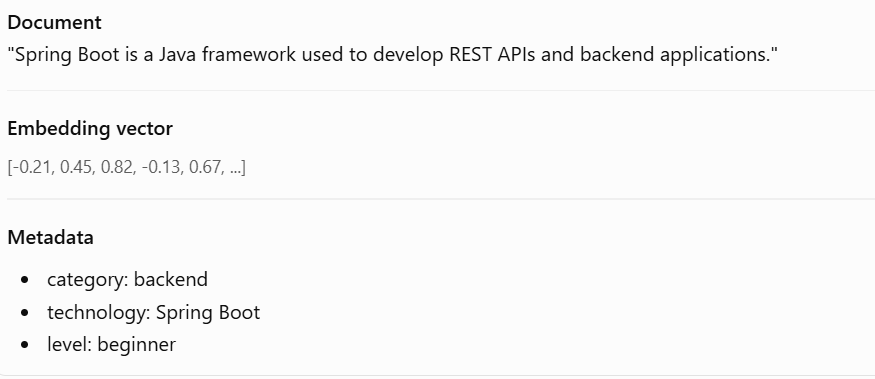
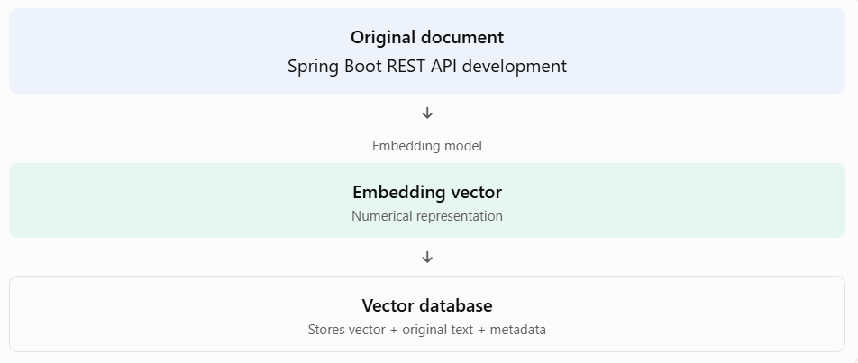

# Topic 4.9 — How Vector Databases Work

### 1. How does a vector database store information?

A vector database doesn't just store an embedding. It typically stores three important things together:

1. Embedding vector: Numerical representation of the document's meaning.
2. Original text: The actual content that we want to retrieve.
3. Metadata: Additional information used to identify or filter documents.

Let's use your AI Skill and Career Management Platform as an example.

Imagine we want to store this career-learning document:


The vector represents meaning, the text contains the original content, and metadata provides useful context.

**Why store all three?**

Because finding a relevant vector is only part of the job. Your application also needs the actual document to show to the student and its metadata to organize the results.

### 2. How are embeddings stored?

Let's understand the flow:


In Spring AI, the `VectorStore` abstraction makes this process easier. Depending on the implementation, it uses the configured embedding model to generate vectors when documents are added.

### 3. What are collections and tables?

Vector databases organize stored information into logical groups.

For example, our career platform might organize documents like this:

| Collection         | Stored information    |
| ------------------ | --------------------- |
| `java_documents`   | Java tutorials        |
| `spring_documents` | Spring Boot tutorials |
| `career_documents` | Career roadmaps       |

In PostgreSQL with pgvector, we can use ordinary database tables with vector columns instead of a separate collection system.

### 4. What is similarity search?

Similarity search finds documents whose embeddings are closest to the embedding of a user's query.

Example:

User searches:

> I want to learn Java backend development.

The vector database might return:

| Retrieved document               | Relevance |
| -------------------------------- | --------- |
| Spring Boot REST API Development | High      |
| Java Microservices Tutorial      | High      |
| Introduction to HTML             | Low       |

The database compares the query embedding with stored document embeddings and retrieves the most relevant results.

### 5. What is Top-K nearest neighbor search?

Top-K means retrieving the K most similar documents to a query.

For example:

```
K = 3
```

The database returns the three most relevant documents.

Why is this useful?

Imagine your career platform has 10,000 learning documents. You don't want to send all 10,000 documents to Gemini. You want only the most relevant documents.

Top-K helps limit the results.

### 6. What is metadata filtering?

Sometimes semantic similarity alone isn't enough.

Suppose a student searches:

> Teach me Java backend development.

But the student wants beginner-level material only.

We can filter documents using metadata:

```
category = backend
level = beginner
```

Now the vector database searches for semantically similar documents while restricting results to the specified metadata.

Important distinction:

- Similarity search finds documents based on meaning.
- Metadata filtering restricts which documents are eligible for retrieval.

### 7. Complete vector retrieval process

Let's connect everything:

1. Document ingestion

   Your application receives career documents.
2. Embedding generation

   The embedding model converts documents into vectors.
3. Storage

   The vector database stores embeddings, original text, and metadata.
4. User query

   A student asks a question.
5. Query embedding

   The embedding model converts the question into a vector.
6. Similarity search

   The database compares the query vector against stored vectors.
7. Filtering and Top-K

   Relevant results are selected, optionally using metadata filters.
8. Retrieved documents

   Your application receives the relevant text and can provide it to Gemini.

## 8. Practical Spring AI example

Let's see how Spring AI's `VectorStore` abstraction simplifies adding and searching documents.

```
@Service
public class CareerSearchService {

    private final VectorStore vectorStore;

    public CareerSearchService(VectorStore vectorStore) {
        this.vectorStore = vectorStore;
    }

    public void addDocuments() {

        List<Document> documents = List.of(
            new Document(
                "Spring Boot is used to build Java REST APIs.",
                Map.of(
                    "category", "backend",
                    "level", "beginner"
                )
            ),
            new Document(
                "React is a JavaScript library for building user interfaces.",
                Map.of(
                    "category", "frontend",
                    "level", "beginner"
                )
            )
        );

        vectorStore.add(documents);
    }

    public List<Document> searchDocuments(String query) {

        SearchRequest request = SearchRequest.builder()
                .query(query)
                .topK(3)
                .similarityThreshold(0.70)
                .filterExpression("category == 'backend'")
                .build();

        return vectorStore.similaritySearch(request);
    }
}
```

This is a focused service example; it assumes that your vector store and embedding model are already configured.

Let's understand the important methods:

| Method                       | Purpose                              |
| ---------------------------- | ------------------------------------ |
| `vectorStore.add()`          | Adds documents and their embeddings. |
| `SearchRequest.builder()`    | Creates search configuration.        |
| `.query()`                   | Defines the user's search text.      |
| `.topK(3)`                   | Requests up to three results.        |
| `.similarityThreshold(0.70)` | Sets a minimum similarity threshold. |
| `.filterExpression()`        | Applies a metadata filter.           |
| `similaritySearch()`         | Retrieves matching documents.        |

Notice something important: **we don't manually generate embeddings in this service**. The configured vector store handles embedding generation when adding and searching documents.
